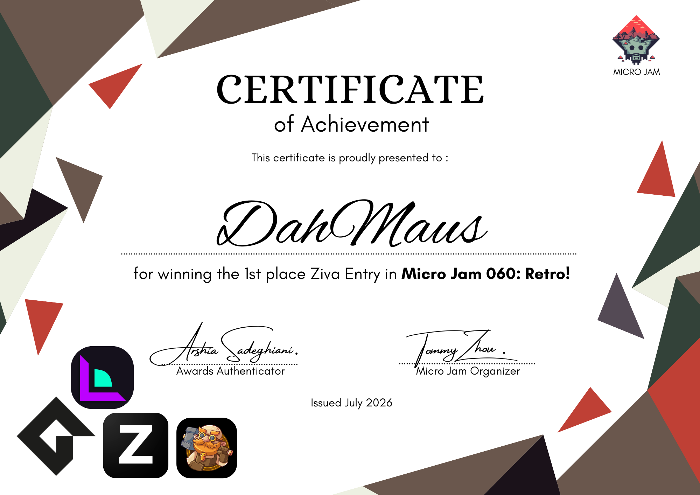

### PROgramming
*making slop games AND software*

### Tech skills lmfao

| Field | Tech |
| :--- | :--- |
| **Game Dev** | **Unity (Main)**, **Godot (not anymore learning, it sucks)** |
| **App Dev** | Android (Java & Kotlin) |
| **Automation** | Python (Website Bots) |
| **Modding** | Minecraft Java (made a HackClient lol) |
| **Security** | Cyber Security |

### Current focus
* **GameDev** Mostly in Unity, 2D is my strength can make 3d also though
* **Youtube** Programming for my YT channel(s) 

### gamejam
* **Micro Jam Ziva Win:** First Game Jam ever participated

**reach me at:** @dahmaus - Discord, Tiktok, chess.com and @DahMaus in Minecraft

